  

 

I'm an ML engineer based in **Cairo**, and I build **computer vision systems**: OCR that reads Arabic and Latin scripts, visual inspection for factory lines, and the APIs, apps and dashboards that put those models in front of users. I care about the full path from data to deployment, and I report honest numbers on how well a model really performs.

<table>
<tr>
<td align="center" width="25%"><h3>95%</h3>OCR accuracy on InkVision (Arabic + Latin)</td>
<td align="center" width="25%"><h3>4+ yrs</h3>building ML &amp; computer vision</td>
<td align="center" width="25%"><h3>20+</h3>engineers mentored in robotics &amp; software</td>
<td align="center" width="25%"><h3>🏆 NASA</h3>Space Apps Challenge winner, 2021</td>
</tr>
</table>

## 🔭 Right now

- **ML Engineering Trainee**, DEPI × AWS ML Engineer Track: SageMaker, MLOps, model versioning and monitoring
- **AI Trainer & Model Evaluator**, Alignerr (Labelbox): evaluating generative AI for reasoning and safety, and writing RLHF data for ML and software engineering
- **Building [inBetween](https://github.com/Ziad-irl/inbetween)**, a trusted peer-to-peer rental marketplace for Egypt and MENA

## 🧪 Selected work

<table>
<tr>
<td width="50%" valign="top">

### 👁️ [InkVision OCR](https://github.com/Ziad-irl/InkVisionProject)
Multilingual OCR engine in **PyTorch** with custom attention layers. It reads Arabic and Latin text and serves mobile apps in real time through a REST API.

**→ 95% accuracy**

`PyTorch` `OpenCV` `Attention` `REST API`

</td>
<td width="50%" valign="top">

### 🍅 [Tomato Disease Pipeline](https://ziad-irl.github.io/#work)
End-to-end vision pipeline: data collection, augmentation, rebalancing of rare disease classes with a weighted loss, training, and optimization to run on field hardware.

**→ Data to edge deployment**

`PyTorch` `TensorFlow` `Edge ML` `Data Eng.`

</td>
</tr>
<tr>
<td width="50%" valign="top">

### 🏭 [IllumiScan Defect Detection](https://ziad-irl.github.io/#work)
Automated visual QA for industrial parts using a classic CV pipeline (adaptive thresholding, morphology, contour analysis). It needs no training data, runs in milliseconds, and every decision can be explained.

**→ 92% validated detection**

`OpenCV` `Python` `Image Processing`

</td>
<td width="50%" valign="top">

### 🤝 [inBetween](https://github.com/Ziad-irl/inbetween)
Rental marketplace with escrowed payments, held deposits, photo handovers and bilingual Arabic (RTL) and English UX. It's a TypeScript monorepo with CI.

**→ In active development**

`Next.js` `NestJS` `PostgreSQL + PostGIS` `Prisma`

</td>
</tr>
<tr>
<td width="50%" valign="top">

### 💸 [MoneyFlow](https://github.com/Ziad-irl/MoneyFlow)
Full-stack expense manager: a Flutter mobile client, a Node.js + MongoDB backend, real-time analytics dashboards and JWT authentication.

`Flutter` `Node.js` `MongoDB` `JWT`

</td>
<td width="50%" valign="top">

### ⚡ [ExcelSearchPro](https://github.com/Ziad-irl/ExcelSearchPro)
Desktop and CLI tool that searches millions of spreadsheet rows instantly, with regex, real-time filtering and export. It ships as a standalone executable.

`Python` `Pandas` `GUI` `CLI`

</td>
</tr>
</table>

<a href="https://ziad-irl.github.io/#lab"><b>▶ Try four of my models live in your browser</b></a> (OCR, defect detection, augmentation and a neural net trained from scratch)

## 🛠️ Toolkit

<table>
<tr><td><b>Machine learning</b></td><td>PyTorch · TensorFlow · scikit-learn · Attention / Transformers · RLHF &amp; LLM evaluation</td></tr>
<tr><td><b>Computer vision</b></td><td>OpenCV · OCR · Defect detection · Image classification · Data augmentation · Edge deployment</td></tr>
<tr><td><b>MLOps &amp; cloud</b></td><td>AWS · SageMaker · Docker · REST APIs · Git · CI</td></tr>
<tr><td><b>Data</b></td><td>Pandas · NumPy · Power BI · PostgreSQL · MongoDB · Data pipelines</td></tr>
<tr><td><b>Apps &amp; backend</b></td><td>Flutter · Node.js · NestJS · Next.js · .NET</td></tr>
</table>

  

## 💼 Experience

| When | Role | Where |
| --- | --- | --- |
| 2026 – now | ML Engineering Trainee, AWS ML Engineer Track | **DEPI** |
| 2025 – now | AI Trainer & Model Evaluator (remote contract) | **Alignerr · Labelbox** |
| Jul 2025 | AI & Data Analysis Intern: Power BI dashboards, data pipelines, C#/.NET modules | **Ministry of Communications & IT** |
| 2020 – 2023 | Co-Founder & Tech Director: grew the community 150% and mentored 20+ peers | **Empire Robotics & Innovation Hub** |

## 🏆 Recognition

- 🥇 **Winner**, NASA Space Apps Challenge (2021)
- 🔬 **National Finalist**, Intel ISEF Egypt (2021)
- 🤖 **3rd Place**, IEEE Micromouse autonomous maze robotics (2019)
- 🎓 **Valedictorian**, October STEM High School, GPA 4.0 (2023)

 

**Open to ML engineering roles, internships and freelance computer vision work.** 
I speak Arabic (native) and English (fluent), and I'm learning Japanese 🇯🇵. I usually reply within 24 hours.

  

